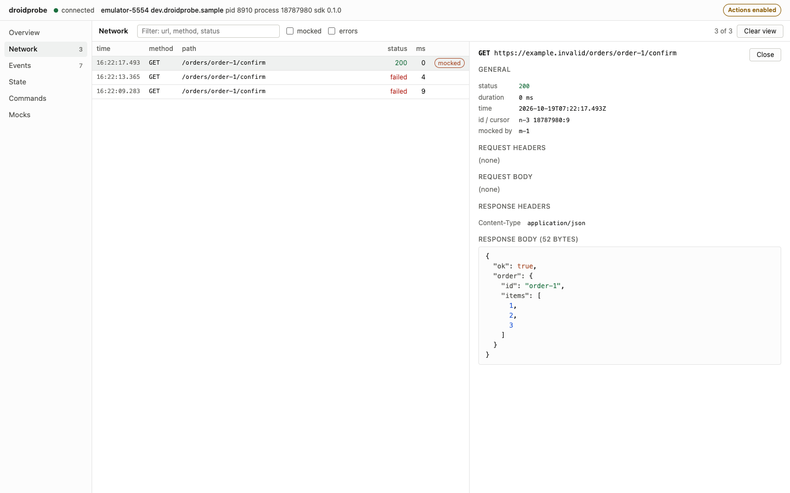

# probe

Command line client for the droidprobe SDK. It reaches a debug build over
`adb forward` and speaks the protocol in [../docs/protocol.md](../docs/protocol.md).

## Build

```sh
make build        # or: go build -o bin/probe ./cmd/probe
make test         # or: go test ./...
```

Requires Go 1.26 and `adb` (on `PATH`, under `$ANDROID_HOME/platform-tools`, or via `--adb`).

## Usage

```text
probe devices [--json] [--prune]
probe list
probe describe <command>
probe call <command> [--input JSON | --input-file FILE|-] [--since CURSOR]
probe watch <command> [--input JSON | --input-file FILE|-] [--since CURSOR]
                      [--limit N] [--timeout DURATION] [--until JQ]
probe cursor
probe ui [--port PORT] [--open] [--allow-actions]
```

Target flags work with every command: `-s SERIAL` (or `ANDROID_SERIAL`) and `-p PACKAGE`.
With one device and one app exposing a probe socket, both can be omitted.

- stdout carries JSON only: `call`, `list` and `describe` print the result `data` on one line,
  `watch` prints one event per line. `cursor` prints the bare head cursor, so `C=$(probe cursor)` works.
- `--since` sets `since` in the input. `--until` is a jq expression evaluated on each event;
  the first truthy result (anything but `false`/`null`) ends the watch.
- `watch` stops at `--limit` events, at `--timeout` (default 30s, `0` disables), or when the app ends the stream.
- Every run removes its own `adb forward`, also on SIGINT/SIGTERM and timeouts. `probe devices`
  only reports existing `*.probe` forwards on stderr; `probe devices --prune` removes them. Pruning is
  opt-in because a forward may belong to a probe still running in another shell.
- `call`, `list` and `describe` give up after 60s (exit 4). The app already times calls out after 10s,
  so this cap only guards against a hung app.
- With `--since` on a command whose input schema has no `since` (checked with `describe`), the
  value is dropped with a warning, because the SDK rejects unknown input fields.

## Dashboard: `probe ui`

`probe ui` serves a local web dashboard for one app until Ctrl-C (exit 0). It prints
`{"url": ..., "allowActions": ...}` on stdout; `--open` also opens the browser.



- Panels: Overview (probe.info, process, Activities, fragment tree, lifecycle transitions), Network
  (live table, request and response detail), Events (source chips, name filter), State (one live card
  per `*.state.watch` command), Commands (forms generated from `describe`), Mocks.
- **Read-only by default.** `/api/call` answers 403 `READ_ONLY` for any command outside the read-only
  allowlist: `probe.info` and names ending in `.state`, `.records`, `.record`, `.list`, `.templates`,
  `.activities`, `.fragments` or `.process`. Mocks, `probe.config`, `lifecycle.startActivity`, `*.invoke`
  and app commands need `--allow-actions`. The page shows the mode in the top bar.
- It binds 127.0.0.1 only (`--port` defaults to 7070 and accepts `127.0.0.1:PORT`; `0` picks a free port).
  Requests whose `Host` or `Origin` is not loopback are refused.
- One app connection is shared by every tab. When it drops, the server retries every second. A new
  `processStartId` emits a `new-process` status event and a `marker` in every stream, and active
  streams restart on the new connection.
- The server keeps the last 2000 entries of each stream, tagged with `processStartId`, so a reload or
  a late tab sees them. Streams whose schema declares `since` resume from the last cursor, or replay the
  app's retained journal for a new process. The app-side watch is cancelled when the last tab closes.
- With no app running yet, it keeps retrying discovery; pass `-p` when several apps expose a socket.
- The page holds exactly one long-lived connection, `/api/bus`, and subscribes streams on it. Browsers
  allow six HTTP/1.1 connections per origin, so one EventSource per stream would leave `fetch` calls
  queued behind them. `/api/stream` and `/api/status` remain for curl and scripts.

| endpoint | answer |
|---|---|
| `GET /api/hello` | the connection's hello plus `serial` and `allowActions`; 503 `DISCONNECTED` while reconnecting |
| `GET /api/list` | the app's `list`, each command with an added `readOnly` flag |
| `GET /api/describe?cmd=` | the app's `describe` |
| `POST /api/call` | body `{"command", "input"}`; the result `data`, or `{"error": {code, message}}` with the app's code (422, 504 for `TIMEOUT`), 403 `READ_ONLY` or 503 `DISCONNECTED` |
| `GET /api/bus` | Server-Sent Events for one tab: `bus` `{bus}` first, then `status`, `new-process` and `stream` events. Each `stream` event is `{sub, type, data, psid}` with `type` `reset`, `live`, `record`, `marker`, `end` or `error`, in the same order as `/api/stream` |
| `POST /api/subscribe` | body `{"bus", "sub"?, "cmd", "input"?}`; starts relaying that stream on the bus and answers `{"sub"}`. A chosen `sub` lets the page route events that arrive before the answer. 404 `UNKNOWN_BUS` once the bus has closed |
| `POST /api/unsubscribe` | body `{"bus", "sub"}`; answers `{"removed": bool}`. Closing the bus drops all of its subscriptions |
| `GET /api/stream?cmd=&input=` | Server-Sent Events: `reset`, the retained history, `live`, then one default event per record `{"psid", "data"}`, `marker` on a new process, and a final `end` or `error` |
| `GET /api/status` | Server-Sent Events: `status` snapshots (`connecting`, `connected`, `disconnected`, with `processStartId` and `connects`) and `new-process` |

## Exit codes

| code | meaning |
|---|---|
| 0 | success; watch hit `--until`, `--limit` or the app ended the stream |
| 1 | the app returned an error (`UNKNOWN_COMMAND`, `INVALID_INPUT`, `STALE_CURSOR`, ...) |
| 2 | usage: bad flags or JSON input, jq compile error, ambiguous device or app |
| 3 | connection: no device or app, closed before hello, protocol major mismatch |
| 4 | timeout: `--timeout`, app `TIMEOUT`, the 60s call cap, or `--until` unmet when the stream ends or `--limit` is reached |
| 130 | interrupted by SIGINT/SIGTERM; the watch is cancelled and the forward removed first (shell convention, 128 + SIGINT) |
